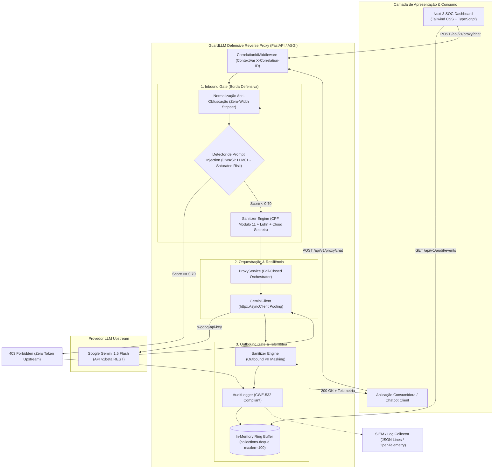

# 🛡️ GuardLLM — Defensive Security Reverse Proxy for LLMs

[](https://github.com/DanRod01/guard-llm/actions/workflows/ci.yml)
[](https://github.com/DanRod01/guard-llm/pkgs/container/guardllm-backend)
[](https://github.com/gitleaks/gitleaks)
[](https://aquasecurity.github.io/trivy/)
[](https://www.python.org/)
[](https://fastapi.tiangolo.com/)
[-e92063.svg)](https://docs.pydantic.dev/)
[](https://astral.sh/uv)
[](https://docs.astral.sh/ruff/)
[](https://mypy-lang.org/)
[-brightgreen.svg)](https://docs.pytest.org/)
[](LICENSE)

O **GuardLLM** é um proxy reverso defensivo de alta performance e segurança de ponta a ponta projetado para inspecionar, sanitizar e auditar interações com Modelos de Linguagem (LLMs) em produção. 

Atuando como um **AI Security Gateway** intermediário entre aplicações e provedores de IA (como Google Gemini e OpenAI), o GuardLLM neutraliza riscos críticos do **OWASP Top 10 for LLMs** — em especial **LLM01 (Prompt Injection & Jailbreak)** e **LLM06 (Sensitive Information Disclosure)** — além de assegurar conformidade estrita com normas globais de privacidade (**LGPD e GDPR**).

---

## 🏛️ Arquitetura do Repositório

O projeto segue princípios estritos de **Clean Architecture**, **Separation of Concerns (SoC)** e a metodologia **Twelve-Factor App**:

```text
guard-llm/
├── backend/
│   ├── pyproject.toml              # Dependências, tooling (Ruff, Mypy, Pytest) e empacotamento
│   ├── uv.lock                     # Lockfile determinístico com integridade de hash
│   ├── .env.example                # Template seguro de variáveis de ambiente
│   ├── src/
│   │   └── guardllm/
│   │       ├── api/
│   │       │   └── v1/
│   │       │       ├── endpoints/  # Rotas HTTP versionadas (health, sanitization, injection, proxy)
│   │       │       └── router.py   # Agregador central de rotas v1
│   │       ├── core/
│   │       │   ├── config.py       # Pydantic-settings imutável e fail-fast
│   │       │   └── middleware.py   # CorrelationIdMiddleware para rastreamento distribuído
│   │       ├── schemas/            # Contratos Pydantic V2 (Rust Core, extra="forbid", frozen)
│   │       │   ├── health.py
│   │       │   ├── sanitization.py
│   │       │   ├── injection.py    # Categorias, payloads e vereditos de Prompt Injection
│   │       │   ├── proxy.py        # Modelos para chat, auditoria e telemetria LLMOps
│   │       │   └── audit.py        # Esquemas estruturados para SIEM (CWE-532 compliant)
│   │       ├── security/
│   │       │   ├── sanitization/   # Motor de redação de PII (Módulo 11 e Luhn)
│   │       │   │   ├── engine.py   # SanitizerEngine com resolução de sobreposição de spans
│   │       │   │   └── rules.py    # Algoritmos de checksum e assinaturas regex pré-compiladas
│   │       │   └── injection/      # Motor de mitigação de Prompt Injection (OWASP LLM01)
│   │       │       ├── detector.py # InjectionDetector com scoring probabilístico saturado
│   │       │       └── patterns.py # Normalização anti-obfuscação e regras multicategoria
│   │       ├── services/           # Camada de integração com provedores e orquestração
│   │       │   ├── gemini.py       # Cliente HTTP assíncrono com pooling e headers seguros
│   │       │   ├── proxy.py        # ProxyService: orquestrador do pipeline Dual-Gate
│   │       │   └── audit.py        # AuditLogger: emissor estruturado em JSON para SIEM/SOC
│   │       └── main.py             # Entrypoint ASGI com lifespan e middlewares registrados
│   └── tests/
│       ├── conftest.py             # Fixtures assíncronas em memória (httpx.ASGITransport)
│       ├── api/                    # Testes de integração de endpoints (/health, /sanitize, /injection, /proxy)
│       ├── core/                   # Testes do middleware de Correlation ID e sanitização de headers
│       ├── security/               # Testes dos algoritmos matemáticos e mitigação de injeção
│       └── services/               # Testes unitários do cliente Gemini, proxy e audit logger
├── frontend/                       # Dashboard de Monitoramento SOC em Nuxt 3 + Tailwind CSS
│   ├── components/                 # Componentes de UI (Navbar, MetricsCards, SecurityPlayground, AuditFeed, EventModal)
│   ├── composables/                # Cliente de API reativo (useGuardApi) com rastreamento distribuído
│   ├── types/                      # Contratos TypeScript espelhando schemas de auditoria e proxy
│   ├── nuxt.config.ts              # Configuração do Nuxt 3 com Vite e Tailwind CSS
│   ├── tailwind.config.ts          # Design System corporativo Dark Mode
│   └── app.vue                     # Layout principal orquestrando o painel de segurança
└── .gitignore                      # Regras determinísticas de exclusão (Python, Node, Nuxt)
```

---

## 🔄 Fluxo de Segurança: O Padrão Dual-Gate (Inbound & Outbound)

O GuardLLM implementa uma proteção bidirecional rigorosa com observabilidade distribuída e mitigação de ameaças na borda:



### Detalhamento do Pipeline de Inspeção

```
[ Aplicação Consumidora / Chatbot ]
              │
              ▼ (Prompt com possíveis ataques ou dados sensíveis)
    ┌────────────────────────────────────────────────────────┐
    │ 1. CORRELATION ID & INBOUND GATE                       │
    │    - Injeção de X-Correlation-ID para rastreio no SIEM │
    │    - Desobfuscação (remoção de Zero-Width Unicode)    │
    │    - Detecção de Prompt Injection (OWASP LLM01)        │
    │      • Bloqueio preventivo (403 Forbidden) na borda    │
    │    - Validação algorítmica: Módulo 11 (CPF)            │
    │    - Validação algorítmica: Algoritmo de Luhn (Cartão) │
    │    - Detecção de segredos (Gemini, OpenAI, AWS, GitHub)│
    │    - Desempate ganancioso de spans sobrepostos         │
    │    - Substituição por tokens seguros [REDACTED_...]    │
    └────────────────────────────────────────────────────────┘
              │ (Prompt Válido e Sanitizado)
              ▼
    ┌────────────────────────────────────────────────────────┐
    │ 2. RESILIENT LLM DISPATCH (Google Gemini API)          │
    │    - Connection Pooling com httpx.AsyncClient          │
    │    - Autenticação via cabeçalho x-goog-api-key         │
    │    - Controle de timeout (30s) e fail-closed           │
    │    - Fechamento gracioso de conexões no lifespan       │
    └────────────────────────────────────────────────────────┘
              │ (Resposta bruta gerada pelo modelo)
              ▼
    ┌────────────────────────────────────────────────────────┐
    │ 3. OUTBOUND GATE & ESTRUTURAÇÃO SIEM                   │
    │    - Inspeciona o texto retornado contra alucinações   │
    │    - Mascara PIIs antes da entrega final ao usuário    │
    │    - Agrega telemetria LLMOps (tokens e latência)      │
    │    - Emite evento JSON para SIEM (CWE-532 compliant)   │
    └────────────────────────────────────────────────────────┘
              │
              ▼
[ Resposta Higienizada + Metadados de Auditoria ]
```

---

## 🚀 Roteiro de Desenvolvimento (Building in Public)

- [x] **Fase 1: Fundação do Core ASGI e Arquitetura**
  - Setup de dependências e lock determinístico com `uv`.
  - Configuração *fail-fast* via `pydantic-settings` e gerenciamento de *lifespan*.
  - Probes de saúde com `StrEnum` e timestamps conscientes em UTC (mitigação CWE-200).
- [x] **Fase 2: Motor de Sanitização Bidirecional de PII (OWASP LLM06)**
  - Detecção e mascaramento de **CPFs** e **CNPJs** com validação matemática do **Módulo 11** da Receita Federal (zero falsos positivos em IDs numéricos).
  - Mascaramento de cartões de crédito via **Algoritmo de Luhn** (Módulo 10 - ISO/IEC 7812).
  - Assinaturas de **JSON Web Tokens (JWT - RFC 7519)** e segredos de nuvem (Google Gemini, OpenAI, AWS IAM, GitHub Tokens).
  - Algoritmo de resolução de sobreposição de spans com ordenação gananciosa e reconstrução linear $O(N)$.
- [x] **Fase 3: Proxy Reversivo Assíncrono com Dual-Gate & Integração Gemini**
  - Orquestrador de proxy com proteção de entrada (*Inbound Gate*) e saída (*Outbound Gate*).
  - Cliente assíncrono para Google Gemini com *Connection Pooling* persistente via `httpx`.
  - Autenticação estrita via cabeçalho HTTP (`x-goog-api-key`), eliminando vazamentos em URLs/logs.
  - Arquitetura *Fail-Closed* com mapeamento semântico de erros (HTTP 502, 503 e 504).
  - Observabilidade LLMOps: métricas de latência em milissegundos e consumo de tokens.
- [x] **Fase 4: Detecção Heurística de Prompt Injection e Jailbreak (OWASP LLM01)**
  - Camada de pré-processamento com remoção de caracteres invisíveis Unicode (Zero-Width Characters anti-obfuscação).
  - Motor de regras multicategoria: System Override, DAN/Developer Mode Jailbreaks, vazamento de System Prompt e manipulação de delimitadores.
  - Scoring de risco probabilístico saturado: $\text{risk\_score} = 1 - \prod (1 - w_i)$.
  - Bloqueio preventivo na borda (*Fail-Closed Block*) com HTTP 403 Forbidden e zero consumo de tokens upstream.
- [x] **Fase 5: Logs de Auditoria Estruturados para SIEM e OpenTelemetry**
  - Middleware de rastreabilidade distribuída `CorrelationIdMiddleware` propagando `X-Correlation-ID` de forma segura.
  - Esquema padronizado de eventos em JSON Lines (`AuditEvent`) compatível com ECS e OpenTelemetry.
  - Mitigação ativa de **CWE-532 (Zero Plaintext PII)**: proibição absoluta de registro de dados confidenciais ou segredos em texto claro nos logs.
  - Emissão com severidades SecOps (`INFO`, `WARNING`, `CRITICAL`), telemetria FinOps (tokens) e latência em milissegundos.
  - Suíte de testes automatizados passando em menos de 0.35s.
- [x] **Fase 6: Dashboard de Monitoramento em Nuxt 3 + Tailwind CSS**
  - Painel de controle *Single-Pane-of-Glass* corporativo para SecOps e FinOps.
  - *Ring Buffer* circular em memória no backend (`collections.deque(maxlen=100)`) servindo `/api/v1/audit/events` e `/api/v1/audit/stats`.
  - *Security Playground & Dual-Gate Inspector* interativo com presets de ataque (DAN, System Prompt Leak, PIIs) e medidor visual de risco de injeção.
  - Trilha forense ao vivo com Correlation ID propagado, badges de severidade e inspeção de payloads JSON (mitigação CWE-532).
  - Suíte de 47 testes automatizados cobrindo o backend e frontend compilado em Nuxt 3 com Vite e TypeScript.

---

## 🛠️ Stack Tecnológica e Ferramentas

| Componente | Tecnologia | Decisão Técnica |
| :--- | :--- | :--- |
| **Linguagem & Runtime (Backend)** | Python 3.11+ | Suporte nativo a `StrEnum`, `datetime.UTC` e concorrência assíncrona moderna |
| **Framework Web (Backend)** | FastAPI | Framework ASGI assíncrono de alto rendimento para I/O-bound de LLMs |
| **Validação de Schemas** | Pydantic V2 | Motor em Rust (`pydantic-core`) com `extra="forbid"` contra *parameter tampering* |
| **Gerenciador de Pacotes Python** | `uv` (Astral) | Resolução de dependências ultrarrápida e integridade determinística de *supply chain* |
| **Qualidade & Linters** | Ruff & Mypy Strict | Análise estática instantânea e tipagem estrita com 100% de cobertura (48 arquivos) |
| **Cliente HTTP** | `httpx` | Conexões assíncronas com pooling persistente e controle granular de timeouts |
| **Suíte de Testes** | Pytest-Asyncio | Testes assíncronos em memória via `ASGITransport` e mocks determinísticos (0.26s) |
| **Framework Web (Frontend)** | Nuxt 3 (Vue 3 + Vite) | Arquitetura reativa, auto-imports limpos e renderização rápida |
| **Estilização & Design System** | Tailwind CSS | Interface corporativa Dark Mode minimalista inspirada no Linear/Vercel |
| **Ícones Vetoriais** | `@lucide/vue` | Ícones vetoriais modernos e leves para operações de segurança |

---

## ⚡ Começando (Quick Start)

### 🐳 Opção 1: Execução com Docker Compose (Recomendada)

Com o Docker instalado, você sobe o proxy reverso FastAPI e o dashboard SOC em Nuxt 3 de forma orquestrada:

```bash
# 1. Clone o repositório
git clone https://github.com/DanRod01/guard-llm.git
cd guard-llm

# 2. Configure sua chave de API
export GEMINI_API_KEY="sua_chave_gemini" # Linux/macOS
$env:GEMINI_API_KEY="sua_chave_gemini"   # Windows PowerShell

# 3. Inicie todos os serviços com orquestração automática
docker compose up -d --build
```
> * **Dashboard SOC (Frontend):** `http://localhost:3000`  
> * **Swagger UI (Backend):** `http://localhost:8000/docs`  
> * **Probe de Saúde:** `http://localhost:8000/api/v1/health`

---

### 💻 Opção 2: Execução Manual Local

#### Pré-requisitos
- Python 3.11 ou superior e [uv](https://astral.sh/uv)
- Node.js 18+ e pnpm (ou npm)

#### 1. Configurar e Executar o Backend
```bash
cd backend
uv sync --extra dev
cp .env.example .env
# Defina sua GEMINI_API_KEY no arquivo .env
uv run pytest -v
uv run uvicorn guardllm.main:app --reload --port 8000
```
- Documentação Swagger da API: [http://127.0.0.1:8000/docs](http://127.0.0.1:8000/docs)
- Probe de Saúde: `GET http://127.0.0.1:8000/api/v1/health`
- Proxy Defensivo: `POST http://127.0.0.1:8000/api/v1/proxy/chat`
- Feed de Auditoria: `GET http://127.0.0.1:8000/api/v1/audit/events`

#### 2. Configurar e Executar o Dashboard (Frontend)
Em um novo terminal:
```bash
cd frontend
pnpm install
pnpm run dev
```
Acesse o Dashboard de Operações de Segurança em **[http://localhost:3000](http://localhost:3000)**.

---

## 📡 Exemplo de Evento Estruturado Emitido para SIEM

Quando uma transação ou ataque é interceptado, o GuardLLM emite um JSON estruturado para o coletor de logs sem expor PIIs em texto claro:

```json
{
  "timestamp": "2026-10-06T21:10:00.123456Z",
  "correlation_id": "a1b2c3d4e5f678901234567890abcdef",
  "event_type": "PROMPT_INJECTION_BLOCKED",
  "severity": "CRITICAL",
  "http_status": 403,
  "client_ip": "192.168.1.100",
  "model": null,
  "latency_ms": 1.45,
  "security": {
    "inbound_entities_count": 0,
    "inbound_entity_types": [],
    "outbound_entities_count": 0,
    "outbound_entity_types": [],
    "injection_detected": true,
    "injection_risk_score": 0.98,
    "injection_categories": ["ROLEPLAY_JAILBREAK", "SYSTEM_OVERRIDE"]
  },
  "token_usage": null,
  "message": "Ataque de Prompt Injection neutralizado na borda. Score: 0.98"
}
```

---

## 🔒 Postura de Segurança (AppSec Highlights)

- **Mitigação OWASP LLM01 & LLM04**: Bloqueio ativo de tentativas de sobrescrita de regras, personas sem filtros e manipulação de delimitadores, além de limites estritos de payload (`max_length`) contra *Model Denial of Service*.
- **Resistência a ReDoS (CWE-1333)**: Expressões regulares de inspeção com quantificadores de janela limitada (`.{0,100}?`), garantindo execução em tempo linear $O(N)$ imune a *backtracking* catastrófico.
- **Pure ASGI Middleware & Hardening HTTP**: Middleware implementado diretamente sobre o protocolo ASGI (zero cópia de stream em memória) com injeção automática de `X-Content-Type-Options: nosniff`, `X-Frame-Options: DENY`, `Referrer-Policy` e `Cache-Control: no-store`.
- **Conformidade CWE-532**: Logs de auditoria nunca armazenam números de cartão, CPFs, CNPJs, JWTs ou chaves de API em texto puro. Apenas metadados higienizados trafegam para o SIEM.
- **Rastreabilidade com Correlation ID**: Cabeçalho `X-Correlation-ID` propagado e sanitizado contra *Header Injection* em todas as requisições e respostas.
- **Fail-Closed por Padrão**: Falhas em credenciais ou componentes de segurança interrompem a chamada antes de qualquer exposição de dados.
- **Proteção Anti-Obfuscação**: Stripping automático de caracteres invisíveis (Zero-Width Unicode) projetados para contornar analisadores estáticos.
- **Connection Pooling Persistente**: Reutilização de conexões TCP/TLS com o provedor de LLM, economizando centenas de milissegundos por requisição.

---

## 📄 Licença
Distribuído sob a licença MIT. Veja `LICENSE` para mais informações.
